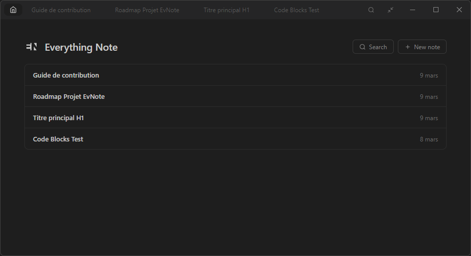

# Everything Note

A fast, keyboard-driven note-taking desktop app built with Angular, Electron, and SQLite.

<p align="center">
  
</p>

<p align="center">
  
</p>

## Features

- **Markdown editor** — CodeMirror 6 with live decorations (headings, bold, italic, code blocks, task lists)
- **Full-text search** — SQLite FTS5 for instant search across all notes
- **Command palette** — `F1` to search notes, commands, and tags
- **Tabs** — drag & drop reordering, pinning, session restore
- **Tables** — GFM tables render as real tables when the caret is elsewhere, and show their aligned markdown when it is inside: `Tab` / `Shift+Tab` jump between cells (`Tab` on the last cell adds a row), pipes are re-aligned on save and on blur, `/table` inserts an empty 2×2 table, and the right-click menu adds / deletes rows and columns and aligns a column. Spreadsheet (TSV) pastes become tables
- **Folders** — nested folders in a VS Code-like tree sidebar (collapsible, resizable, `Ctrl+Shift+E` to toggle): create / rename / delete, drag & drop notes and folders (drop on a folder to move into it, between two rows to position it: an insertion line shows where), note count per folder. Notes created on the fly land in the undeletable `Inbox` folder; the first-launch sample notes live in `Getting started`. 3-4 levels deep are recommended (a warning is shown beyond). `Ctrl+click` / `Shift+click` select several notes and folders: drag them together, `Delete` them (one confirmation) or *Move To…* a folder picked in a dialog. Right-click a folder to *Empty* it (its content is deleted, the folder kept, after a confirmation with the counts). *Color…* opens a color picker (saturation / hue, hex field, presets, recent colors): the icon, the label and a light background take that color
- **Backlinks & graph** — link notes with `[label](Folder/Note title)` (path autocompletion once `](` is typed, like in a code editor) or `note://ID` (palette: `Copy Note Link`). A collapsible panel under the editor lists the notes linking to the active one, with the surrounding text. The home page draws an Obsidian-like graph of the links (canvas + d3-force): zoom, pan, drag nodes, click to open, active note highlighted, orphans on the outer ring, dashed nodes/links for deleted notes, filtered by the folder selected in the sidebar; above 500 notes it is limited to 2 links around the active note. Switch to the plain list with the `Graph / List` toggle. Links render as their label once the caret leaves them; `Ctrl+click` follows them (note, or web address in the browser). Settings: line numbers and word wrap
- **Tag system** — organize notes with tags, filter from the sidebar
- **Quick-note overlay** — a global shortcut (default `Ctrl+Alt+N`, configurable) pops a small translucent, always-on-top chat-like window anywhere on screen; notes sent from it are tagged `overlay` and appear in the app
- **System tray** — closing the window keeps the app running in the tray (right-click > Quit to exit); optional launch at Windows startup
- **Auto-update** — the app checks the latest GitHub release at startup then hourly (packaged Windows build only) and offers the update in a popup, with an entry in the sidebar above Settings; the installer is SHA-512 verified. The `Automatic Updates` setting downloads in the background and installs when the app closes. Releases (tags `v*`) publish a `latest.json` manifest next to the installer
- **Settings editor** — VS Code-like modal (`Ctrl+,`) with search, categories and reset to default
- **Light & dark themes** — dark by default; **Settings → Appearance → Theme** (Dark / Light / System, following the OS) or the `Ctrl+K Ctrl+T` chord to flip. Every color is a CSS variable `--evn-*` defined per `data-theme` in `src/styles.scss` (the editor syntax colors too, so CodeMirror needs no per-theme extension): a new theme = a new `:root[data-theme='…']` block. The choice lives in `settings.json` and is mirrored in localStorage so an inline script in `index.html` applies it before the first paint. The quick-note overlay keeps its own dark translucent look
- **Formatting bar** — Word-like toolbar (styles, bold/italic/strike/code, blocks, lists) between the tabs and the editor, buttons reflect the formatting under the caret (read from the syntax tree) and never steal the editor focus. `Alt+T` toggles it; **Settings → Formatting Bar** turns it off for good and sets its size (Full / Compact), style (Pinned / Floating) and position (Top / Bottom)
- **Keyboard-first** — every action has a shortcut (see below)
- **Local storage** — all data stays on your machine in a SQLite database

## Tech Stack

| Layer | Technology |
|-------|-----------|
| Frontend | Angular 22 (standalone components, signals, OnPush) |
| Editor | CodeMirror 6 with custom markdown decorations |
| Desktop | Electron 44 (frameless window, custom title bar) |
| Database | better-sqlite3 with FTS5, WAL mode, cached prepared statements |
| Build | electron-builder (NSIS installer), GitHub Actions CI/CD |

## Architecture

```
electron/
  main.ts            # Main process — window management, IPC handlers
  overlay.ts         # Quick-note overlay window (show/hide, position memory)
  overlay-geometry.ts# Pure helpers: default/saved overlay position, resize anchoring
  global-shortcut.ts # Global shortcut registration (keeps the previous one on failure)
  settings.ts        # settings.json persistence (userData)
  settings-schema.ts # Settings type, defaults, validation
  renderer-loader.ts # Loads the Angular bundle (#overlay selects the overlay root)
  tray.ts            # System tray icon & menu
  updater.ts         # Update check (hourly), verified download, silent install on exit/restart
  update-manifest.ts # Pure helpers: version comparison, manifest validation
  startup.ts         # Launch at startup (login item, started hidden with --hidden)
  preload.ts         # Context bridge (electronAPI)
  database.ts        # SQLite schema + migration (folders, notes.folder_id), FTS5 triggers, CRUD operations

src/app/
  core/
    services/        # NotesService, FoldersService, SidebarStateService (persisted in localStorage), TabsService, BacklinksService (backlinks + graph data), PaletteService, ShortcutsService, ThemeService (applies `data-theme`)
    models/          # TypeScript interfaces (Note, Folder, Tab, PaletteItem)
    utils/           # Pure helpers (folder-tree.util: tree building, move validation, sidebar width; note-links.util: `note://` parsing, backlinks, graph)
  features/
    editor/          # CodeMirror markdown editor with auto-save
    backlinks/       # Backlinks panel under the editor
    graph/           # Graph view (home page)
    sidebar/         # Folder tree (drag & drop, inline rename, context menu), overlay notes, tags, settings button
    home/            # Note list of the selected folder / tag, context menu
    tabs/            # Tab bar with drag & drop, pinning, window controls
    palette/         # Command/search/tag palette (F1 / Ctrl+Shift+F)
    overlay/         # Quick-note overlay root component (bootstrapped on #overlay)
    settings/        # VS Code-like settings modal (Ctrl+,), driven by settings-definitions.ts
  shared/
    codemirror/      # Editor highlight style (colors from theme tokens), markdown decorations, widgets
    context-menu/    # Reusable context menu component
    ui/              # Themed checkbox, select, confirm dialog, focus-select directive
```

## Keyboard Shortcuts

Every in-app shortcut below is a default and can be rebound in **Settings → Keyboard Shortcuts** (click a shortcut, press the new combination; `↺` restores the default). A combination already used by another action is refused. Overrides are stored in `settings.json` (`appShortcuts`); the list of rebindable actions is `APP_SHORTCUTS` in `src/app/core/models/app-shortcuts.model.ts` — add an entry there, then bind a handler with `ShortcutsService.bindAction(id, …)`. `Esc` (close dialogs) and `Ctrl+R` (blocked reload) are fixed.

| Shortcut | Action |
|----------|--------|
| `F1` | Command palette |
| `Ctrl+N` | New note |
| `Ctrl+Shift+E` | Toggle sidebar |
| `Ctrl+K` `Ctrl+T` (chord) | Toggle light / dark theme |
| `Ctrl+W` | Close tab |
| `Ctrl+F` | Find in editor |
| `Ctrl+Shift+F` | Search all notes |
| `Ctrl+Tab` / `Ctrl+Shift+Tab` | Next / previous tab |
| `Ctrl+S` | Save note |
| `Ctrl+B` / `Ctrl+I` / `Ctrl+Shift+K` | Bold / italic / link |
| `Alt+P` | Pin/unpin tab |
| `Alt+Z` | Toggle wide mode |
| `Alt+T` | Toggle formatting bar |
| `Alt+Ctrl+1-9` | Jump to tab by index |
| `Ctrl+,` | Settings |
| `Ctrl+Alt+N` (global, configurable) | Toggle the quick-note overlay (or show the app, see settings) |

In the overlay: `Enter` sends (`Shift+Enter` = new line) — or, if configured, `Enter` = new line and `Ctrl+Enter` sends. `Esc` or a click outside hides it; the draft is kept.

## Getting Started

### Prerequisites

- Node.js 20+
- npm

### Install & Run

```bash
# Install dependencies
npm install

# Rebuild native modules for Electron
npm run electron:rebuild

# Start in development mode (Angular dev server + Electron)
npm run dev
```

### Build for Production

```bash
# Build Angular + compile Electron TypeScript
npm run build

# Package as Windows installer (.exe)
npm run dist
```

## License

MIT
